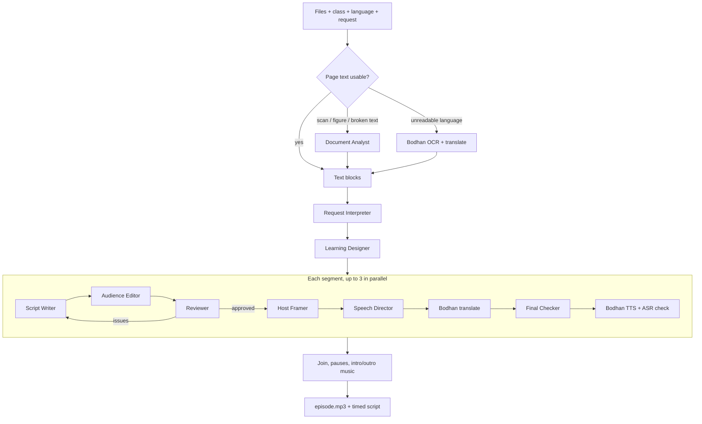

# Jigyasa Talks (जिज्ञासा टॉक्स)

**Turn any textbook chapter into a friendly, accurate podcast, in your language and at your class level.**

A student uploads a chapter (a PDF, a photo of a page, or Word / PowerPoint notes). Jigyasa Talks writes a conversation that explains it, checks every line against the source, and records it with natural Indian voices. The PDF page follows the audio while you listen. Any segment can be revised by asking the AI, edited by hand, or regenerated.

Built with a team of nine AI agents (through [OpenRouter](https://openrouter.ai)) and Bodhan AI for Indian-language speech, translation and OCR.

---

## Contents

- [Key features](#key-features)
- [How it works](#how-it-works)
- [Setup and installation](#setup-and-installation)
- [Using the app](#using-the-app)
- [Configuration](#configuration)
- [Project structure](#project-structure)
- [Testing](#testing)
- [Troubleshooting](#troubleshooting)
- [Limitations](#limitations)

---

## Key features

**Faithful to the textbook**
- Every factual line is tagged with the source block it came from.
- A second model (from a different model family than the writer) fact-checks each segment, for up to three rounds.
- Lines that still cannot be confirmed are removed rather than kept.
- A final check after translation catches changed numbers, flipped negations and swapped terms. It understands the Indian number system: 10 lakh = 1 million.

**Multilingual from end to end**
- **Input:** PDFs in English and Indian languages. Languages the models cannot read reliably (Konkani, Maithili, Sanskrit…) are read with Bodhan OCR and translated to English for the agents.
- **Broken text:** text layers broken by older Indian-language fonts are detected, and those pages are read from the page image instead.
- **Instructions in any language:** the student's request in Hindi, Tamil, etc. is translated for the agents. The original words are kept, so topic names still match the PDF.
- **Output:** podcasts in 20+ Indian languages. The agents write and check in English, Bodhan translates the approved lines, and the final checker verifies the translation.
- **Interface:** available in 12 languages (English + 11 Indian languages), with the app name in each language's own script.

**Sounds like a real podcast**
- **Four formats:** two friends, teacher and student, an interview with an expert, or a single narrator.
- **Welcome and goodbye:** written to fit the format (a teacher opens with "Good morning, students!") and the class level.
- **Voice style per line:** storytelling for examples, calm for definitions, surprise for a "wow" fact, and so on, using Bodhan's TTS styles. The class level and format adjust the style.
- **One recording per speaker turn,** with about a second of pause between speakers.
- **Intro and outro music:** the first line starts 2 s into the intro; the outro begins 2 s before the goodbye ends.

**Made for students**
- **Simple first step:** pick your class (Primary, Middle, Secondary, Senior Secondary) and a language, then tap Create. Everything else sits under "Customize".
- **Guided setup:** a welcome screen with three steps, and a plain question to confirm each file's language.
- **Customize:** length (including custom minutes), level of detail (including your own description), subject, whole material or one topic, and "explain the background first".
- **Length that holds:** the voices' real speaking speed is measured per language, so a 2-minute podcast stays close to 2 minutes.
- **Player:** the source page follows the audio, switches between PDFs automatically, and the sidebar folds away for a wider view.
- **Edit any segment:**
  - **Revise with AI:** shows whether your change was made, and why not if it couldn't be.
  - **Edit it myself:** your words go straight to speech, no AI.
  - **Make a new version:** written again from scratch.
  - Every version is kept and can be switched back.

**Uploads:** PDF, photos of pages (JPG, PNG, WEBP, GIF, BMP, TIFF), Word (`.docx`), PowerPoint (`.pptx`), text (`.txt`, `.md`). Several files can be combined in one podcast; each one is covered.

---

## How it works



| Agent | Default model | Job |
|---|---|---|
| Document Analyst | `google/gemini-2.5-flash` (vision) | Reads scanned or photographed pages, figures, tables, equations |
| Request Interpreter | `openai/gpt-4.1-mini` | Works out what to cover, the student's needs and setting changes |
| Learning Designer | `openai/gpt-4.1-mini` | Plans segments, key points and word budgets; covers every file |
| Script Writer | `openai/gpt-4.1-mini` | Writes the dialogue with a source reference on every factual line |
| Audience Editor | `openai/gpt-4.1-mini` | Rewords for the class level without changing facts |
| Reviewer | `google/gemini-2.5-flash` | Checks against the source; judges whether a requested change was made |
| Host Framer | `google/gemini-2.5-flash-lite` | Writes only the welcome and the goodbye, in the style of the format |
| Speech Director | `google/gemini-2.5-flash-lite` | Picks a voice style per line; makes symbols and formulas speakable |
| Final Checker | `google/gemini-2.5-flash` | Compares approved and spoken lines: numbers, negations, terms |

Orchestration is plain Python, not an AI planner, so the order is predictable and every step is saved. The models keep no memory between calls. Each call is sent exactly what it needs, and all state lives in the session folder on disk.

---

## Setup and installation

### Requirements

- Python 3.10 or newer
- [ffmpeg](https://ffmpeg.org/download.html) (any recent version), on your `PATH` or set in `.env`
- An [OpenRouter](https://openrouter.ai) API key
- Bodhan AI API keys: speech, and translation (plus OCR if your key does not cover it)

### Install

```bash
git clone https://github.com/<your-username>/jigyasa-talks.git
cd jigyasa-talks

python -m venv .venv
# Windows
.venv\Scripts\activate
# macOS / Linux
source .venv/bin/activate

pip install -r requirements.txt
```

### Configure

```bash
cp .env.example .env        # Windows: copy .env.example .env
```

Open `.env` and fill in at least:

| Setting | What it is |
|---|---|
| `OPENROUTER_API_KEY` | Key for the language models |
| `BODHAN_API_KEY` | Key for Bodhan text-to-speech (and speech recognition) |
| `BODHAN_TRANSLATE_API_KEY` | Key for Bodhan translation (needed for most Indian-language podcasts) |
| `BODHAN_OCR_API_KEY` | Optional: only if OCR needs its own key |
| `HOST_A_VOICE`, `HOST_B_VOICE` | Two different Bodhan voices |
| `HOST_A_NAME`, `HOST_B_NAME` | The speakers' names, used in the welcome |
| `FFMPEG_PATH`, `FFPROBE_PATH` | Only if ffmpeg is not on your `PATH` |

Keys are read only from `.env`, which is excluded from git. Never commit it.

### Music (optional)

Put `intro.mp3` and `outro.mp3` in `assets/` (any common audio format works; see `assets/README.md`). To check the setup:

```bash
python -m app.music_check
```

This mixes your music with a 5-second test tone into `data/music_check.mp3` and reports any problem.

### Run

```bash
python -m uvicorn app.main:app --port 8000
```

Open <http://127.0.0.1:8000>. At start-up the terminal prints whether the intro and outro music were found.

---

## Using the app

1. **New podcast**, then add your material. Each file shows the language it was detected in. Confirm it, or correct it so the file is read again in that language.
2. **Create your podcast:** choose your class and the language to listen in, then tap **Create podcast**. Open **Customize your podcast** for the format, subject, length, level of detail, a specific topic, a request in your own words, or "explain the background first".
3. **Listen:** segments become playable as soon as each is ready. The PDF page follows the audio. Click any line to play from there. Hover a translated line to see its checked English original.
4. **Edit a segment:** tap **Edit segment**, then choose:
   - **Revise with AI:** quick changes or your own request. The segment then shows whether the change was made.
   - **Edit it myself:** change the words; only the audio is re-recorded.
   - **Make a new version:** written again from scratch.

   Earlier versions stay available in the version picker.
5. **Download MP3** saves the full episode with music.

Follow-up requests in the same podcast space make new podcasts. The Request Interpreter knows what was made earlier in that space, and only that space.

---

## Configuration

Everything you might want to change without touching code lives in plain files. Changes are picked up on the next request, with no restart needed.

| File | What it controls |
|---|---|
| `config/agents.yaml` | The model and temperature for each agent (or override with `MODEL_<AGENT>=` in `.env`) |
| `prompts/*.md` | The instructions each agent receives |
| `config/options.yaml` | Class levels, formats (with their welcome/goodbye style), subjects, lengths, levels of detail, languages and how each is handled, voice deliveries and their Bodhan styles, interface languages and app names |
| `static/i18n/*.json` | Interface text: English and the saved translations |
| `.env` | Keys, voices, names, pauses, music levels, length tuning (`TTS_WPM`), final check, parallelism |

**Languages:** in `options.yaml`, `via: en` means a podcast language is written and checked in English, then translated. `understood: false` means PDFs in that language are read with OCR and translation.

**Voice styles:** each delivery (`warm`, `explaining`, `story`, `calm`, …) maps to a Bodhan style. `style_overrides` adjusts the style by class level and format.

---

## Project structure

```
jigyasa-talks/
├── app/
│   ├── main.py              HTTP API (FastAPI), thin layer over the modules below
│   ├── orchestrator.py      One request end to end; segment jobs; revisions; episode + music
│   ├── producer.py          One segment: writer → editor → reviewer → framer → director → translate → check → TTS
│   ├── documents.py         Uploaded files → page images + text blocks (direct, vision or OCR route)
│   ├── converters.py        Photos, Word, PowerPoint, text → PDF pages
│   ├── translation.py       Bodhan translation with script, cut-off and fidelity checks
│   ├── instructions.py      Student instructions in any language → English for the agents
│   ├── options.py           Choices, labels, prompt fragments, word-budget arithmetic
│   ├── speech_rates.py      Measured speaking speed per language (keeps length accurate)
│   ├── store.py             One folder per podcast space; safe saving on disk
│   ├── i18n.py              Interface text in each language
│   ├── config.py            Settings from .env
│   ├── music_check.py       Command-line check of the intro/outro setup
│   ├── agents/              One module per agent; base.py is the only place that calls a model
│   ├── llm/                 OpenRouter client
│   └── speech/              Bodhan client (TTS, ASR, translation, OCR) and ffmpeg helpers
├── config/                  agents.yaml, options.yaml
├── prompts/                 One system prompt per agent
├── static/                  index.html (the whole interface, no build step) and i18n/
├── assets/                  intro.mp3 / outro.mp3 (yours)
├── tests/                   Fake services and the end-to-end test
├── .env.example             Template for your .env
└── requirements.txt
```

At runtime the app creates `data/`:
- `data/sessions/<id>/` holds each podcast space: `state.json`, the files, page images, text blocks and audio.
- `data/speech_rates.json` holds the measured voice speeds.

---

## Testing

The tests run the real server against fake versions of every external service (language models, Bodhan TTS, ASR, translation and OCR), so they need no keys and cost nothing.

```bash
# terminal 1
DATA_DIR=/tmp/podtest python tests/run_mock_server.py          # Windows PowerShell: $env:DATA_DIR="C:\temp\podtest"; python tests/run_mock_server.py

# terminal 2
python tests/e2e.py http://127.0.0.1:8765
```

The end-to-end suite runs 135 checks, covering:
- review rounds and removal of unconfirmed lines;
- translated podcasts, and the final checker catching a deliberately wrong number;
- lakh/million equivalence;
- requests in Hindi;
- photo, Word and PowerPoint uploads;
- multi-file planning;
- the three ways to edit a segment;
- music placement and pause lengths;
- word budgets;
- voice styles;
- interface languages.

---

## Troubleshooting

| Problem | Fix |
|---|---|
| `ffmpeg was not found` | Install ffmpeg, or set `FFMPEG_PATH` and `FFPROBE_PATH` in `.env` |
| No intro/outro music | Check the two `[music]` lines printed at start-up; run `python -m app.music_check` |
| Old interface after an update | Press Ctrl + F5 once |
| `Access is denied` on Windows | Usually antivirus scanning a file; the app retries automatically. Optionally exclude the project folder in Windows Security |
| Podcasts too long or too short in a new language | The speed is learned after the first podcast; to tune the starting value, set `TTS_WPM` in `.env` |
| A Bodhan 429 error | Rate limit: lower `MAX_PARALLEL` in `.env` |
| `ConnectionResetError [WinError 10054]` in the terminal | Harmless Windows message when the browser cancels an audio request; it can be ignored |

---

## Limitations

- Accuracy depends on the source. The agents use only your material, so they cannot add facts it does not contain, and they inherit any errors or bias in it.
- There is no dedicated bias or stereotype check yet, and the approach has not been evaluated with students for learning outcomes.
- Bodhan offers a fixed set of voice styles; the same mapping is used for every language.
- Very long documents are capped (`MAX_PDF_PAGES`, `MAX_VISION_PAGES` in `.env`).
